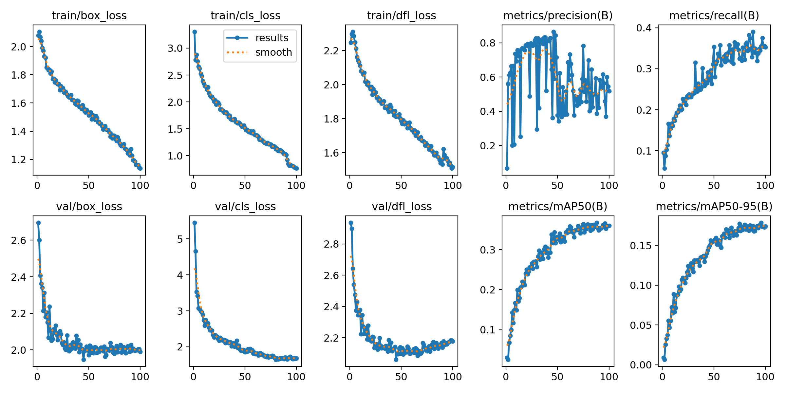
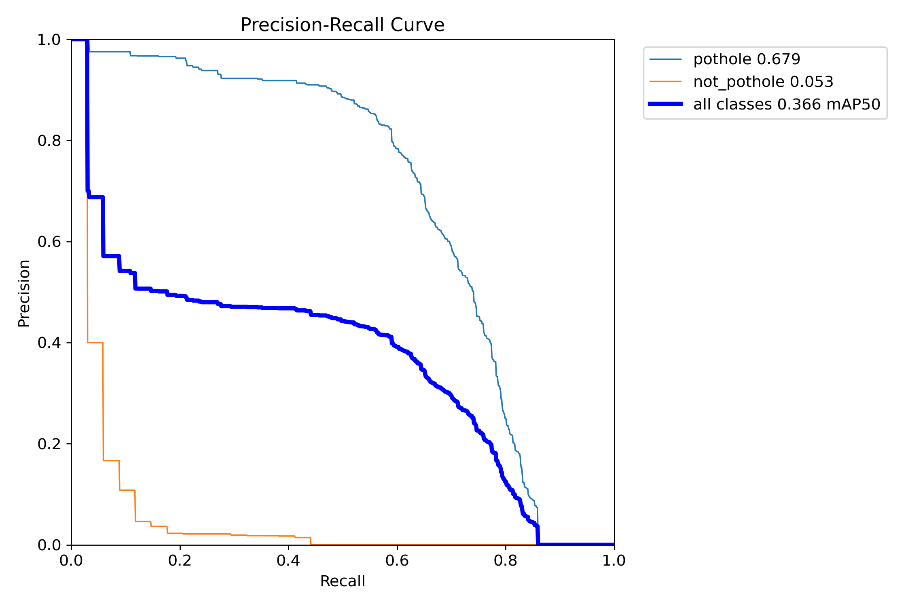
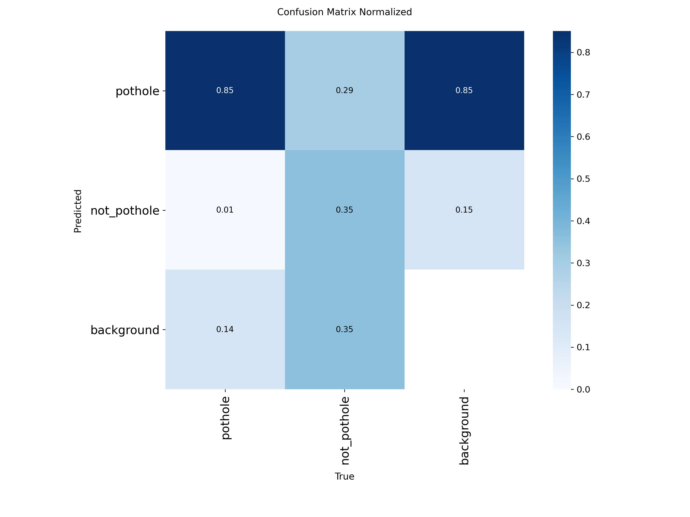

# PotholesDetector

Detects potholes in dashcam video with YOLOv8 and geotags each one using the GPX track recorded with the video.

**Full report:** [`report.pdf`](report.pdf).

**Kaggle dataset:** https://www.kaggle.com/datasets/sudinrupakheti/potholes

**v1 notebook:** https://www.kaggle.com/code/sudinrupakheti/potholes-notebook

**v2 notebook:** https://www.kaggle.com/code/sudinrupakheti/pothole-notebook-2

**Github repo:** https://github.com/sudinrupakheti/PotholesDetector

## What it does

Input: dashcam video + matching `.gpx` file.

Output, saved to `outputs/<video name>/`:

- `annotated.mp4`: video with detection boxes, GPS coordinates, and pothole count overlay.
- `potholes.csv`: one row per pothole event, with time (Nepal time), coordinates, confidence, frame range, number of detections, and a Google Maps link.

Detections of the same pothole in consecutive frames are merged into one event (gap of at most 1.5 s and 20 m between detections).

## Results

| Model | Data | mAP50 | mAP50-95 | Precision | Recall |
|---|---|---|---|---|---|
| v1: YOLOv8n, 640 px | Public dataset only | 0.77 | 0.42 | 0.77 | 0.69 |
| v2: YOLOv8s, 960 px | Public + manually labeled dashcam frames + `not_pothole` hard negatives | 0.36 | 0.17 | 0.52 | 0.35 |

The two rows use **different validation sets** and are not comparable. v1's score is on public-dataset images only and v1 performed poorly on real dashcam video. v2's score includes dashcam frames and is the more realistic number. v2 is still weak. See the report for analysis and limitations, including a frame-leakage risk in the manual data split.





## Setup

Requires [uv](https://docs.astral.sh/uv/) and [ffmpeg](https://ffmpeg.org/) on your PATH (ffmpeg re-encodes the output video for browser playback).

```bash
curl -LsSf https://astral.sh/uv/install.sh | sh   # install uv
uv sync                                           # creates .venv from uv.lock
.venv/bin/python app/main.py                      # opens the web UI
```

**NVIDIA GPU:** After `uv sync`, swap in a CUDA torch build matching your driver:

```bash
uv pip install --python .venv/bin/python --reinstall \
    torch torchvision --index-url https://download.pytorch.org/whl/cu132
```

## Usage

1. Open the web UI and upload the video and its `.gpx`.
2. Set **Confidence**. Lower finds more potholes and more false alarms.
3. Set **Frame skip**. Higher is faster but may miss potholes.
4. Click **Run**.

**Command line detection** (no geotagging):

```bash
yolo predict model=weights/best.pt source=path/to/video.mp4 \
    classes=[0] conf=0.25 imgsz=960
```

## Dataset and training

| Source | Contents | Images |
|---|---|---|
| `my_data_0` | [Indian Roads Dataset](https://www.kaggle.com/datasets/mitangshu11/indian-roads-dataset) (public) | 2067 (1446 train / 310 val / 311 test) |
| `my_data_1` | Frames from [this video](https://www.youtube.com/watch?v=qhf7nx1-sRM), labeled manually | 208 |
| `my_data_2` | Frames from [this video](https://www.youtube.com/watch?v=EmLbz91ZSoY), labeled manually | 600 |

Frames extracted at 1 fps, labeled in [makesense.ai](https://www.makesense.ai/) (YOLO format), merged by `scripts/merge_datasets.py` into one dataset (70/15/15 split for manual data, empty labels kept as background). Two classes: `pothole` and `not_pothole`. At inference only `classes=[0]` is kept, so `not_pothole` works as a hard-negative suppressor.

v2 training: YOLOv8s, 100 epochs, imgsz 960, batch 8, on Kaggle GPU. Full config in `kaggle_runs/result/args.yaml`.

Dataset preparation commands:

```bash
# extract frames from a video for labeling
ffmpeg -i video.mp4 -vf fps=1 -start_number 0 images/frame_%04d.jpg

# fill in empty labels for background images
python scripts/create_missing_labels.py --images images --labels labels

# merge my_data_0/1/2 into one YOLO dataset
python scripts/merge_datasets.py
```

## Limitations

- Reported coordinates are the **vehicle's position** when the pothole was detected, not the pothole's own position. It is typically a few meters ahead.
- Time alignment depends on the video filename timestamp. An offset of 1 s at city speeds shifts positions by several meters.
- Small training set (808 manual frames, two videos). Recall is low, so many potholes are missed.

## Repository layout

```
PotholesDetector/
├── data.yaml                  # v2 training config (2 classes: pothole, not_pothole)
├── app/main.py                # geotagging web app (Gradio)
├── weights/best.pt            # v2 weights
├── report.pdf                 # project report
├── kaggle_runs/
│   ├── training.ipynb         # v2 training notebook
│   └── result/                # v2 run output: plots, results.csv, args.yaml
├── old_model/                 # v1 artifacts
├── scripts/                   # dataset prep utilities
├── pyproject.toml
└── uv.lock
```
